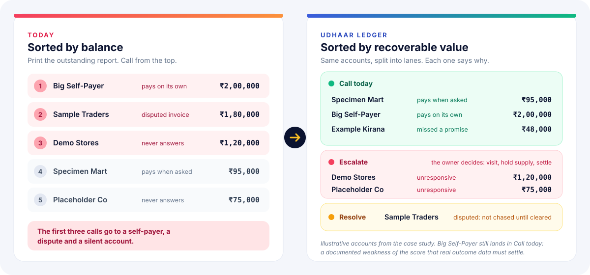
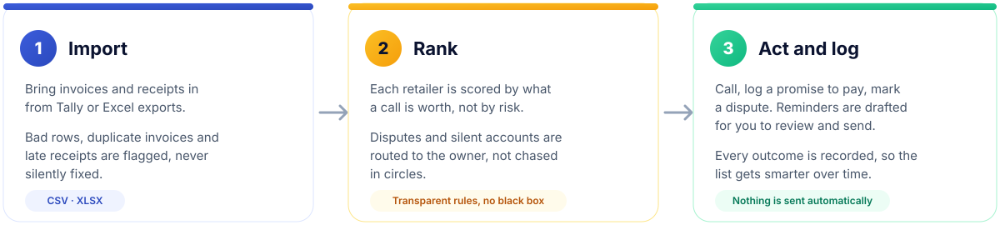
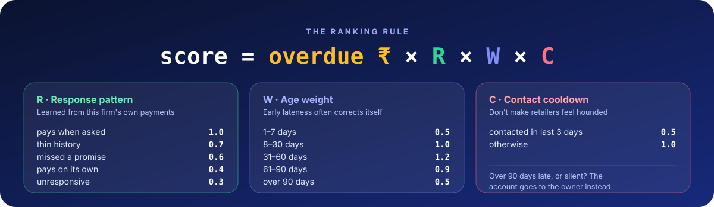
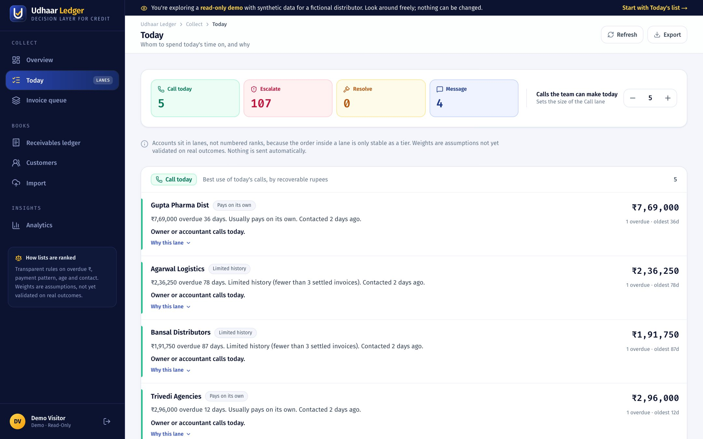
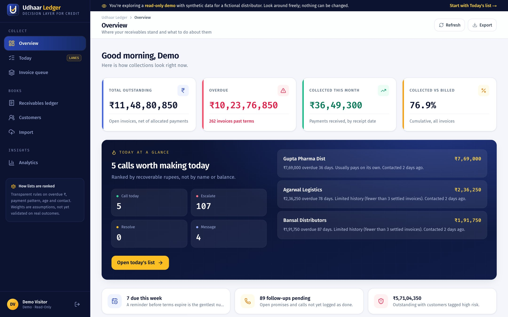
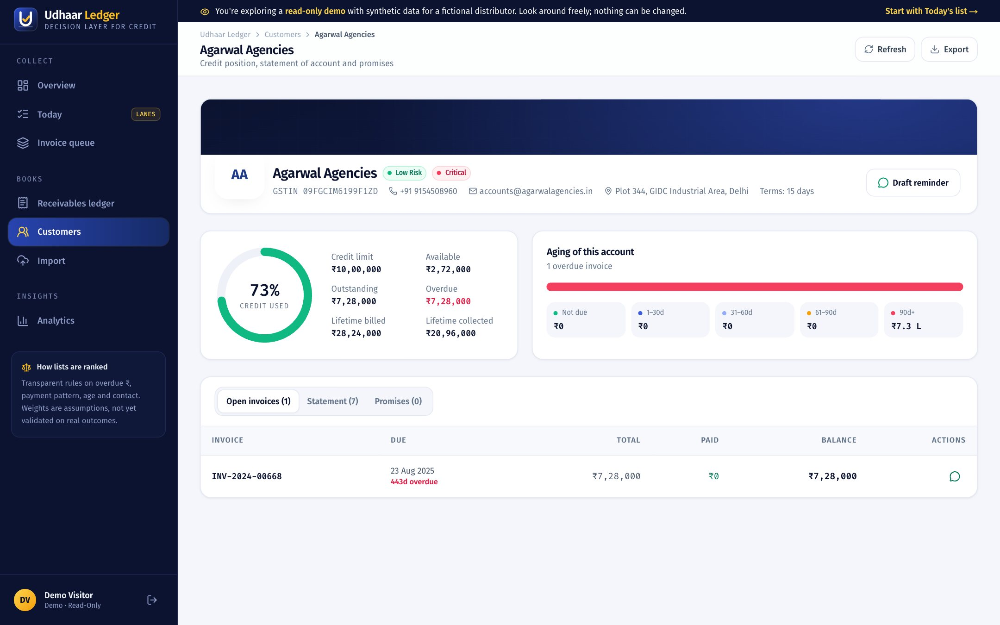
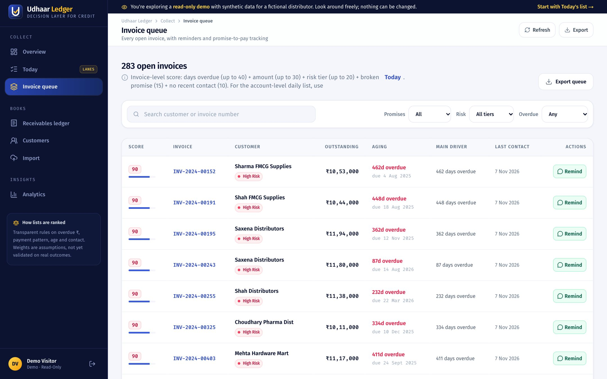
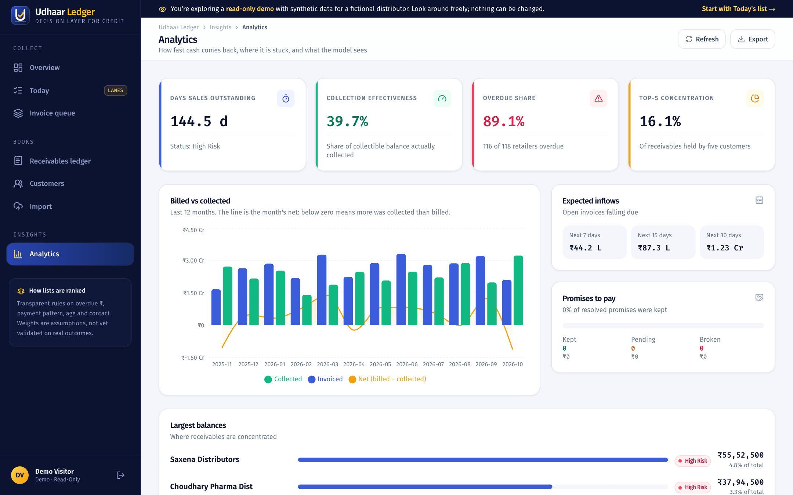
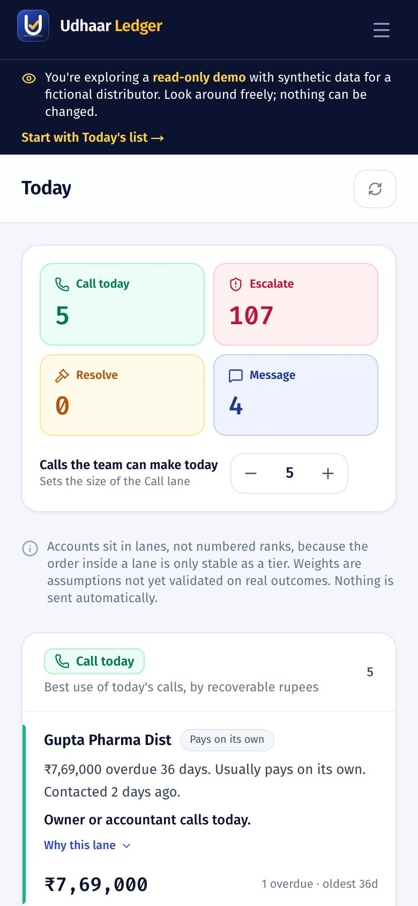
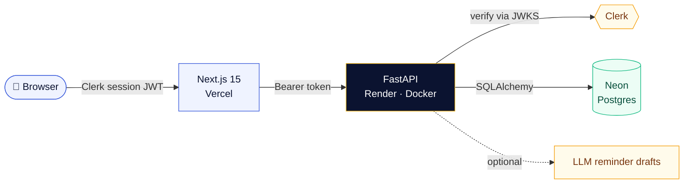

<div align="center">


<br/>

[](https://udhaarledger.vercel.app)
[](https://github.com/adityaagrawall/udhaar-ledger/actions/workflows/ci.yml)
[](https://github.com/adityaagrawall/udhaar-ledger/actions/workflows/security.yml)
[](LICENSE)

**[The problem](#-the-problem)** &nbsp;·&nbsp; **[The idea](#-the-idea)** &nbsp;·&nbsp; **[How it works](#-how-it-works)** &nbsp;·&nbsp; **[Screenshots](#-see-it)** &nbsp;·&nbsp; **[Features](#-features)** &nbsp;·&nbsp; **[Run it](#-run-it-locally)** &nbsp;·&nbsp; **[Deploy](#-deploy)** &nbsp;·&nbsp; **[Security](#-security)**

</div>

<br/>

## 🎯 The problem

Indian distributors sell mostly **on credit** to thousands of small retailers. Collections then run on memory, a printed outstanding report and a lot of phone calls.

<div align="center">

| 💸 Credit is the norm | 📉 Margins are thin | 🧮 Bad debt is expensive |
|:---:|:---:|:---:|
| Up to **90%** of distributor-to-retailer sales are on credit<br/><sub>OkCredit, vendor-reported, no stated method</sub> | Distributor net margins are about **1–6%**, mostly 2–4%<br/><sub>vendor-reported</sub> | At a 4% margin, **one ₹1 lakh write-off** takes about **₹25 lakh of sales** to earn back<br/><sub>arithmetic on the vendor range</sub> |

</div>

And the tools people already have do not help with the hard part. Ledger apps **record** what happened. Tally and billing systems can **enforce** a credit limit. Reminder apps **nag everyone the same way**. Nobody ranks *whom to chase first* and tells you *why*.

> Late payment is mostly a **credit-allocation problem, not a reminder problem.** Credit is granted by people who don't bear its cost, slipping behaviour is invisible until it is overdue, and the owner's limited call time goes to lists sorted by name or balance.


## 💡 The idea

Udhaar Ledger is a **decision layer** that sits on top of your books. It reads invoices and receipts, then each morning answers one question:

> ### *Whom do I spend today's time on, and why?*

<div align="center">

</div>

<br/>

<table>
<tr>
<td width="33%" valign="top">

**🧭 Value of a call, not risk**<br/>
A big balance owed by someone who pays on their own is a poor use of a phone call. The score estimates what a call is *worth*.

</td>
<td width="33%" valign="top">

**🗂️ Lanes, not rank numbers**<br/>
*Call today*, *Escalate*, *Resolve*, *Message*. A ranking is only stable as a tier, so the app doesn't pretend otherwise.

</td>
<td width="33%" valign="top">

**🔍 Every row explains itself**<br/>
Plain-language reasons you can overrule, written from the same factors as the score, plus what would change it.

</td>
</tr>
</table>


## 🧩 How it works



<br/>

The ranking is **transparent rules, not a black box.** Weights are visible assumptions, so an owner can disagree with the list and see exactly why it said what it said.



<br/>

**Lane rules, applied in order**

| # | If the account… | It goes to | Because |
|:-:|---|:-:|---|
| 1 | has a **disputed** invoice | 🟡 **Resolve** | It isn't chased until someone clears the dispute |
| 2 | is **unresponsive**, or **over 90 days** late | 🔴 **Escalate** | The owner decides: visit, hold supply or settle |
| 3 | is among the top **N** by score (you set N) | 🟢 **Call today** | The best use of today's calls |
| 4 | is everything else | 🔵 **Message** | A reviewed reminder is enough |


## 📸 See it

<div align="center">

<br/><sub><b>Today</b> · the daily list: lanes on top, a reason and a suggested action on every row</sub>
</div>

<br/>

<table>
<tr>
<td width="50%" align="center"><br/><sub><b>Overview</b> · receivables, collections and today at a glance</sub></td>
<td width="50%" align="center"><br/><sub><b>Customer dossier</b> · credit use, aging, statement and promises</sub></td>
</tr>
<tr>
<td width="50%" align="center"><br/><sub><b>Invoice queue</b> · every open invoice with reminders and promises</sub></td>
<td width="50%" align="center"><br/><sub><b>Analytics</b> · DSO, collection effectiveness and concentration</sub></td>
</tr>
</table>

<div align="center">
<br/>

<br/><sub><b>Works on a phone</b> · the accountant's daily list, one thumb away</sub>
</div>


## ✨ Features

<table>
<tr>
<td width="50%" valign="top">

#### 🗂️ Lane-based Today list
Account-level ranking, reasons in words, a "what would change this" note, and a banner when receipts are stale so a late ledger can't mislead you.

#### 🧾 Receivables you can trust
Balance is always `invoice total − allocated payments`, never a joined sum. Aging is measured against each invoice's own due date. Over-allocation is rejected and payments are de-duplicated by UTR.

#### 🤝 Promises and disputes
Log a promise to pay, and broken promises raise priority automatically. Mark an invoice disputed and it leaves the chase list until cleared.

</td>
<td width="50%" valign="top">

#### 📥 Careful imports
CSV and Excel with row-level validation. Duplicate invoices are skipped, identical re-uploads are rejected, payments need a real date, and nothing is saved until you review the preview.

#### 💬 Reminders you approve
Bilingual (English and Hindi) WhatsApp and SMS drafts built from verified invoice facts only. An LLM is optional, a template is the fallback, and **nothing is ever sent automatically**.

#### 🧪 Honest analytics
DSO, collection effectiveness, expected inflows and promise-to-pay results. The payment-delay model is clearly labelled **experimental**, trained per organisation on point-in-time features.

</td>
</tr>
</table>


## 🚀 Try it live

**[udhaarledger.vercel.app](https://udhaarledger.vercel.app)** → click **Explore the live demo**. No sign-up.

You are signed into a shared **read-only** account with synthetic data for a fictional distributor (150 customers, 800 invoices). You can browse everything. The server rejects any change, so there is nothing to break.

> ⏱️ The API runs on Render's free plan. If nobody has used it for a while, the first request can take about a minute while it wakes up.

| Role | Can do | How you get it |
|---|---|---|
| 👀 **Viewer** | Read everything, draft reminders | The demo button, or any new sign-up |
| 🛠️ **Manager** | + record payments, log promises, import | Granted by an admin |
| 👑 **Admin** | + retrain the model, manage customers | Emails listed in `ADMIN_EMAILS` |


## 🏗️ Architecture



<div align="center">


</div>


## 🔒 Security

Built as if the data were real. Authentication is **Clerk-only**; the API verifies every session JWT (signature, issuer, expiry, origin) and enforces roles **on the server**, so the read-only demo cannot change anything even by calling the API directly.

| | |
|---|---|
| 🛡️ **Server-enforced access** | Viewers get `403` on any write. A test fails the build if any route answers without a token |
| 🚦 **Rate limits** | Per-IP limits on every route, tighter on demo sign-in, imports, exports and training |
| 🧱 **Headers and CSP** | Strict CSP, HSTS, no framing, `nosniff`, no-store on data responses |
| 🧼 **Input safety** | Bounded fields, upload size, row and zip-bomb limits, CSV formula-injection guard, sanitised LLM prompts |
| 📦 **Supply chain** | `npm audit` and `pip-audit` clean, CodeQL, secret scanning, dependency review |

Full control list and the honest limits: **[SECURITY.md](SECURITY.md)**.


## 💻 Run it locally

Prerequisites: Python 3.11+, Node 20+, PostgreSQL 15+ (or a Neon connection string), [`uv`](https://docs.astral.sh/uv/), and a free [Clerk](https://clerk.com) application.

```bash
# 1. Database (local Postgres)
psql -d postgres -c "CREATE USER collectiq WITH PASSWORD 'collectiq' SUPERUSER;"
psql -d postgres -c "CREATE DATABASE collectiq OWNER collectiq;"
psql -d postgres -c "CREATE DATABASE collectiq_test OWNER collectiq;"

# 2. Backend
cd backend
cp .env.example .env            # add your Clerk keys
uv sync --extra dev
uv run python scripts/generate_synthetic_data.py   # 150 customers, 800 invoices, payments
uv run uvicorn app.main:app --reload --port 8000

# 3. Frontend (new terminal)
cd frontend
cp .env.example .env.local      # add your Clerk keys
npm install
npm run dev -- -p 3000
```

Open http://localhost:3000. Emails in `ADMIN_EMAILS` become admins on first sign-in; everyone else, including the demo visitor, is read-only.

```bash
cd backend && uv run pytest -q     # 79 tests
```

## 🚢 Deploy

| Piece | Service | Notes |
|---|---|---|
| 🗄️ Database | **Neon** | Pooled connection string as `postgresql+psycopg2://…?sslmode=require` |
| 🔌 API | **Render** | [`render.yaml`](render.yaml) Blueprint, Docker runtime from `backend/` |
| 🖥️ Frontend | **Vercel** | Root directory `frontend` |
| 🔐 Auth | **Clerk** | Add your frontend origin to the API's allowed origins |

<details>
<summary><b>Backend environment variables</b></summary>

<br/>

| Variable | Purpose |
|---|---|
| `DATABASE_URL` | Neon connection string |
| `SECRET_KEY` | Random 32+ characters (Render generates one) |
| `ENVIRONMENT` | `production` turns on startup safety checks |
| `CLERK_SECRET_KEY`, `CLERK_ISSUER` | From the Clerk dashboard |
| `CLERK_AUTHORIZED_PARTIES`, `CORS_ORIGINS` | Your frontend origin(s), comma separated |
| `ADMIN_EMAILS` | Who becomes admin on first sign-in |
| `DEMO_ENABLED` | Show the read-only demo button |
| `AUTO_PROVISION_USERS` | `false` makes the app invite-only |
| `DEFAULT_ORG_SLUG` | Organisation new users join (default: first) |

Seed a fresh database once with `DATABASE_URL=<neon url> uv run python scripts/generate_synthetic_data.py`. Trained ML model files live on the instance disk, so they don't survive a restart on Render's free plan.

</details>


## 🧭 Roadmap

Built in the order the case study recommends: baseline first, then the list, then learning from outcomes.

- [x] **Stage 0 · Baseline** — importer, aging against each invoice's own terms, deterministic balances
- [x] **Stage 2 · Live list** — lanes, plain-language reasons, promise and dispute logging
- [ ] **Stage 0 · Baseline metrics** — on-time collection rate (collected within 7 days of due date), over-limit report
- [ ] **Stage 1 · Shadow mode** — build the list without acting on it and compare with what was actually chased
- [ ] **Stage 3 · Advisory credit gate** — an order-time card that warns, never blocks
- [ ] **Stage 4 · Learn** — tune weights from logged outcomes and backtest against the rules
- [ ] **Tally-format importer** — read real Tally exports, the biggest open technical question

## 🧪 Honest limits

This project labels what it knows and what it assumes.

- **The weights are assumptions**, taken from the case study, and have not been validated on real outcomes.
- **All demo data is synthetic.** Results on it say nothing about real distributors.
- **The payment-delay model is experimental.** On the synthetic ledger it separates late from on-time only modestly (ROC-AUC about 0.65), so it is a hint, not a decision-maker. Rules drive the ranking.
- **Tally exports are untested.** The importer reads a generic CSV or Excel layout.

More detail: [`docs/KNOWN_LIMITATIONS.md`](docs/KNOWN_LIMITATIONS.md) · [`docs/ML_EVALUATION.md`](docs/ML_EVALUATION.md) · [`docs/FINANCIAL_VALIDATION.md`](docs/FINANCIAL_VALIDATION.md)

<br/>

<div align="center">


**Udhaar Ledger** · built by [Aditya Agrawal](https://github.com/adityaagrawall) · [MIT License](LICENSE)

<sub>If this idea resonates, a ⭐ helps others find it.</sub>

</div>
