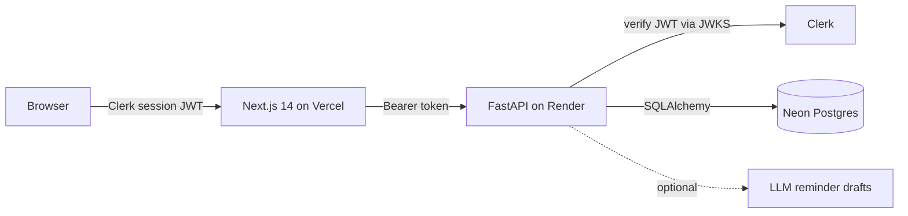

<div align="center">


# Udhaar Ledger

**A decision layer for distributor credit.** A short, ranked, explainable list of whom to chase today, built for Indian distributors and wholesalers.

[](https://github.com/adityaagrawall/udhaar-ledger/actions/workflows/ci.yml)


</div>

## Why this exists

Late collections at small distributors are mostly a **credit-allocation problem, not a reminder problem**. Credit is granted by people who do not bear its cost, slipping behaviour is invisible until it is overdue, and the owner's call time goes to lists sorted by name or balance. Reminders and fixed credit limits already exist in Tally and ledger apps. What is rarely offered is a ranked, explainable daily list with an outcome log.

Udhaar Ledger is that layer. It reads invoices and receipts from Excel or Tally exports, then each morning answers one question: **whom do I spend today's time on, and why?** The design follows the *Udhaar Ledger* case study, which separates evidence from assumption on every claim.

## Try it

**Live demo:** open the app and click **Explore the live demo**. It signs you into a shared, read-only account with synthetic data for a fictional distributor. No sign-up needed. *(Link added after deployment.)*

## What makes it different

- **Lanes, not rank numbers.** Accounts land in *Call today*, *Escalate*, *Resolve* (disputes) or *Message*, because a ranking is only stable as a tier.
- **Value of a call, not risk.** `score = overdue rupees x response pattern x age weight x contact cooldown`. A big balance owed by someone who pays on their own is a poor use of a phone call.
- **Every row explains itself** in plain language and says what would change it.
- **Rules before machine learning.** Weights are visible assumptions; the delay model is a labelled, experimental supporting signal.
- **Humans stay in control.** Nothing is sent automatically; reminders are drafted, reviewed and approved by a person.
- **Honest provenance.** Synthetic data, estimates and measured results are labelled as such.

## Architecture



| Layer | Choice |
|---|---|
| Frontend | Next.js 14 (App Router), TypeScript, Tailwind, Framer Motion, Recharts |
| Auth | Clerk. The API verifies session JWTs; viewers (including the demo) are read-only server-side |
| Backend | FastAPI, Pydantic v2, SQLAlchemy 2, scikit-learn |
| Database | Neon (serverless Postgres) |
| Hosting | Render (API, Docker), Vercel (frontend) |
| CI | GitHub Actions: backend tests, frontend typecheck and build, Docker build |

## Features

### 1. Receivables Dashboard (`/`)
- Real-time KPIs: Total Outstanding, Overdue Receivables, 30-Day Cash Collected, Realized Collection Rate %.
- **Aging Buckets:** Deterministic distribution across `Not Yet Due`, `1–30 Days`, `31–60 Days`, `61–90 Days`, and `91+ Days` (Critically Overdue).
- **Cash Flow Velocity:** Interactive Recharts area chart comparing monthly invoiced value against verified realized payments.
- Workload cards highlighting pending follow-ups, invoices due this week, and high-risk debtor exposure.

### 2. Today — lane-based worklist (`/today`)
Implements the ranking model from the Udhaar Ledger case study (Section 6). Rules, not ML.
- Per **account**: `score = overdue ₹ × R × W × C`
  - **R** (response pattern, derived from this org's own payments and logged follow-ups): pays when asked 1.0, thin history 0.7, missed a promise 0.6, pays on its own 0.4, unresponsive 0.3
  - **W** (age weight): 1–7d 0.5, 8–30d 1.0, 31–60d 1.2, 61–90d 0.9, 90d+ 0.5
  - **C** (contact cooldown): 0.5 if contacted in the last 3 days
- **Lanes:** disputed → *Resolve*; unresponsive or 90d+ → *Escalate*; top N scored → *Call today*; the rest → *Message*. N is set on the page.
- Shows lanes, not rank numbers (the case study's stability check shows order is only stable as a tier). Each row explains itself in words and says what would change it.
- A banner warns when receipts are stale. Disputes can be set via `POST /collections/invoices/{id}/dispute`.
- **All weights are assumptions from the case study and are not validated on real outcomes.** The score's exact weights are in `backend/app/services/today_service.py`.

### 2b. Invoice Queue (`/queue`)
- Invoice-level list using an additive urgency score (overdue duration, amount, customer risk tier, broken promise, follow-up recency; maximum 115). It is a secondary, per-invoice view used for reminders and promise-to-pay tracking.

### 3. Receivables Ledger (`/invoices`)
- Complete invoices explorer with status pills (`paid`, `overdue`, `partial`, `sent`).
- Filter by status, search by customer or invoice number, and toggle overdue-only.
- **Invoice Detail Drawer:** Shows full payment allocation history, transaction dates, payment modes (NEFT/RTGS/UPI), and verified remaining balance.
- One-click CSV export of the receivables ledger.

### 4. Data Import Wizard (`/import`)
- CSV and Excel upload supporting custom column mapping.
- **Row-level validation:** Detects negative numbers, missing required headers, and invalid date formats.
- **Duplicate Prevention:** Invoices whose number already exists in the org are skipped. The file's SHA-256 is stored on the import job for audit. Re-committing an identical file is rejected. Payment rows need a valid `payment_date` and cannot exceed the invoice total.
- Generic CSV/Excel layout only; Tally-export parsing is untested (case study hypothesis H6).
- Sample dataset download button.
- Comprehensive import job audit history table.

### 5. ML Payment-Delay Model (`/analytics`)
- **Status: experimental, supporting signal only.** The case study says rules come first; the ranking above does not use this model.
- **Target Definition:** Delay days past invoice due date upon final settlement.
- **Leakage:** Training features are point-in-time: an earlier invoice counts only if it was fully settled on or before the sample invoice's issue date. Models are stored per organisation and only admins/managers can retrain.
- **Measured results** (chronological hold-out; reproduce with `scripts/benchmark_datasets.py`, output in `backend/app/ml/artifacts/benchmark_report.json`):
  - Synthetic data (105 test invoices): classifier ROC-AUC about 0.65–0.67, accuracy 56–66% vs 51% majority baseline (weak signal); regression MAE 3.1 days vs 7.8 days for a mean predictor.
  - IBM public receivables dataset: classifier ROC-AUC about 0.89–0.90; regression MAE 2.0 vs 4.2 days.
  - Earlier README figures (MAE 1.51, PR-AUC 0.82, 86% directional accuracy) were not reproducible and have been removed.
- Feature importance chart shows the fitted model's top drivers.
- On-demand retraining trigger on closed invoices.

### 6. AI Reminder Assistant (Modal)
- Drafts polite, professional payment reminders tailored for Indian B2B trade.
- Supports **WhatsApp** and **SMS** formats in both **English** and **Hindi (हिंदी)**.
- Strictly grounded in invoice facts; contains explicit guardrails forbidding threats or invented claims.
- **Mandatory Human Approval:** Requires operator confirmation before marking follow-up status as `contacted`.

### 7. Customer Directory & Risk Profiling (`/customers`)
- 150 realistic Indian wholesale accounts with GSTINs, addresses, credit limits, and payment terms (15 to 60 days).
- Real-time exposure calculations for each customer.

---

## Run it locally

Prerequisites: Python 3.11+, Node 20+, PostgreSQL 15+ (or a Neon connection string), [`uv`](https://docs.astral.sh/uv/), and a free [Clerk](https://clerk.com) application.

```bash
# 1. Database (local Postgres)
psql -d postgres -c "CREATE USER collectiq WITH PASSWORD 'collectiq' SUPERUSER;"
psql -d postgres -c "CREATE DATABASE collectiq OWNER collectiq;"
psql -d postgres -c "CREATE DATABASE collectiq_test OWNER collectiq;"

# 2. Backend
cd backend
cp .env.example .env            # add your Clerk keys
uv sync --extra dev
uv run python scripts/generate_synthetic_data.py   # 150 customers, 800 invoices, payments
uv run uvicorn app.main:app --reload --port 8000

# 3. Frontend (new terminal)
cd frontend
cp .env.example .env.local      # add your Clerk keys
npm install
npm run dev -- -p 3000
```

Open http://localhost:3000. Emails in `ADMIN_EMAILS` become admins on first sign-in; everyone else, including the demo visitor, is read-only.

## Authentication

Sign-in is handled entirely by Clerk. The frontend sends a short-lived Clerk session JWT; the API verifies its signature against Clerk's JWKS plus issuer, expiry and authorised origin, then maps the Clerk user to a local user on first sign-in. Viewers can read everything but any change is rejected with `403` by the server, not just hidden in the UI. The demo button asks the API for a one-time Clerk sign-in ticket for a shared read-only account, so no demo password exists. Password login is off unless `ALLOW_LOCAL_JWT=true` (used only by tests), and production refuses to start with a default `SECRET_KEY`.

## Deploy

| Piece | Service | Notes |
|---|---|---|
| Database | **Neon** | Use the pooled connection string as `postgresql+psycopg2://...?sslmode=require` |
| API | **Render** | `render.yaml` Blueprint; Docker runtime from `backend/` |
| Frontend | **Vercel** | Root directory `frontend`; set the three `NEXT_PUBLIC_*` / Clerk variables |
| Auth | **Clerk** | Add your frontend origin to the instance's allowed origins |

Backend environment variables:

| Variable | Purpose |
|---|---|
| `DATABASE_URL` | Neon connection string |
| `SECRET_KEY` | Random 32+ characters (Render generates one) |
| `ENVIRONMENT` | `production` enables startup safety checks |
| `CLERK_SECRET_KEY`, `CLERK_ISSUER` | From the Clerk dashboard |
| `CLERK_AUTHORIZED_PARTIES`, `CORS_ORIGINS` | Your frontend origin(s), comma separated |
| `ADMIN_EMAILS` | Who becomes admin on first sign-in |
| `DEMO_ENABLED` | Show the read-only demo button |
| `DEFAULT_ORG_SLUG` | Organisation new users join (default: first) |

Seed a fresh database once with `DATABASE_URL=<neon url> uv run python scripts/generate_synthetic_data.py`. On Render's free plan the service sleeps when idle, so the first request after a pause takes about a minute, and trained ML model files are not kept across restarts.

## 🧪 Automated Test Coverage

The test suite covers all financial calculations, idempotency, and multi-tenant authorization boundaries:
- `tests/test_balances.py`: Full payment zeroing, partial payment reduction, multiple allocation summing, and immunity to JOIN row multiplication.
- `tests/test_import.py`: CSV preview validation, invalid amount rejection, duplicate invoice detection, and idempotent re-imports.
- `tests/test_auth.py`: JWT login authentication, invalid credentials rejection, 401 unauthenticated guard, and 403 cross-tenant data isolation.

Run tests:
```bash
cd backend && uv run pytest -v
```

---

## 🔒 Security & Reliability

- **Multi-Tenant Isolation:** Every database query enforces tenant filtering by `org_id` extracted from cryptographically verified JWT tokens.
- **Zero Raw LLM Execution:** The LLM provider abstraction is isolated from database access. It cannot execute arbitrary SQL queries.
- **Idempotent Ingestion:** Repeated imports skip invoice numbers that already exist in the org.
